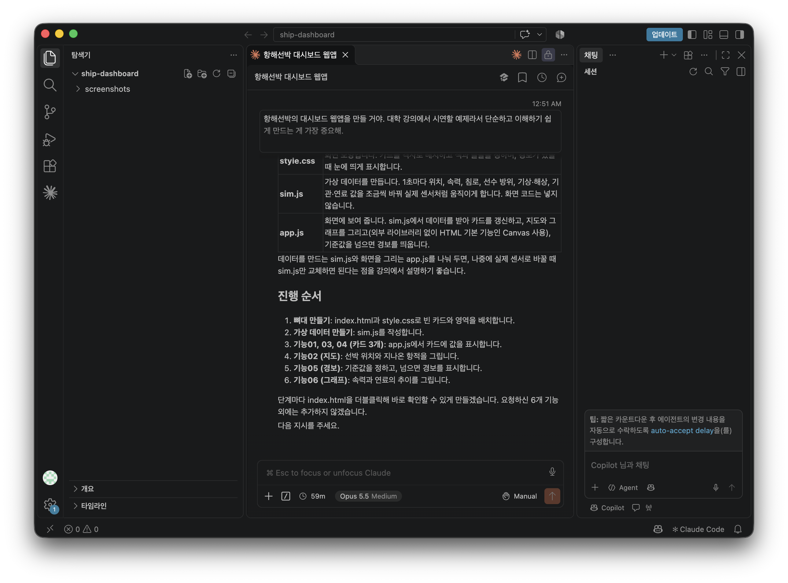
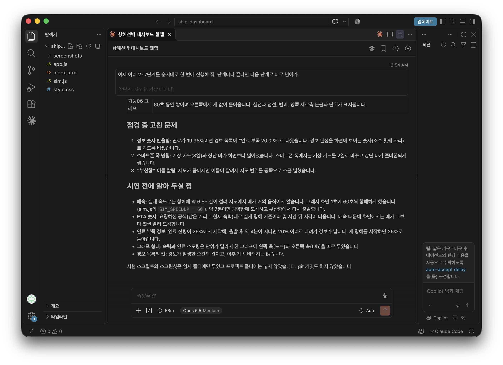
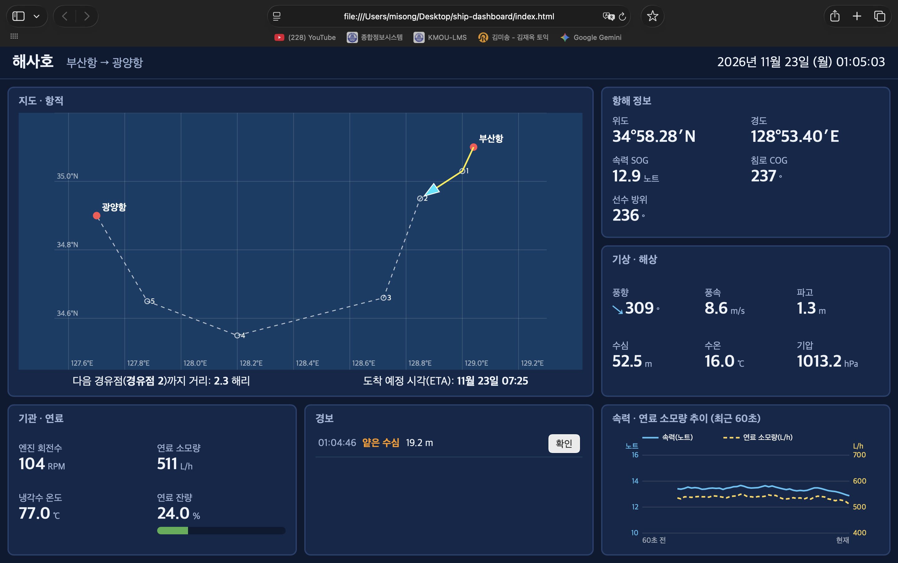

# 12주차 항해선박 대시보드 (Claude 코딩)

가상 센서 데이터로 선박 해사호가 부산항에서 광양항까지 항해하는 모습을 보여 주는 웹 대시보드입니다.

## 사용 기술

- HTML · CSS · JavaScript (프레임워크, 외부 라이브러리, 서버, 빌드 도구 없음)
- 지도와 그래프는 HTML 기본 기능인 Canvas로 직접 그림

## 파일 구성

| 파일 | 역할 |
|---|---|
| `index.html` | 화면 뼈대. 카드와 지도, 경보, 그래프 영역을 배치하고 나머지 파일을 불러옴 |
| `style.css` | 화면 모양. 3열 3행 격자, 어두운 남색 배경, 경보 강조, 스마트폰 폭 대응 |
| `sim.js` | 가상 데이터. 1초마다 위치, 속력, 기상·해상, 기관·연료 값을 조금씩 바꿈 |
| `app.js` | 화면 표시. sim.js의 최신 데이터를 1초마다 가져와 카드, 지도, 경보, 그래프를 갱신 |

데이터(sim.js)와 화면(app.js)을 나눠 두었기 때문에, 실제 센서를 연결할 때는 sim.js만 바꾸면 됩니다.

## 실행 방법

1. 이 저장소를 내려받습니다.
2. `index.html`을 더블클릭합니다. (인터넷 연결 필요 없음)

## 기능

- **기능01 항해 정보**: 위도·경도, 속력(SOG), 침로(COG), 선수 방위
- **기능02 지도와 항적**: 계획 항로(점선), 경유점, 지나온 항적(실선), 선박 위치, 다음 경유점까지 거리, 도착 예정 시각(ETA)
- **기능03 기상·해상 정보**: 풍향(화살표), 풍속, 파고, 수심, 수온, 기압
- **기능04 기관·연료 정보**: 엔진 회전수, 연료 소모량, 냉각수 온도, 연료 잔량(숫자와 막대)
- **기능05 경보**: 얕은 수심(20m 미만), 강풍(20m/s 초과), 엔진 과열(90℃ 초과), 연료 부족(20% 미만)
- **기능06 추이 그래프**: 최근 60초 속력(노트)과 연료 소모량(L/h)

> 시연을 위해 화면의 1초에 실제 60초만큼 항해합니다. 약 7분이면 광양항에 도착하고, 부산항에서 다시 출발합니다.

## 만든 과정

### 1단계: 지시문과 Claude 응답

코드를 작성하기 전에 Claude에게 파일 4개의 역할과 진행 순서를 먼저 설명하게 했습니다.

### 2~7단계: 완료 후 VS Code 화면

2~7단계 지시를 한 번에 내렸고, Claude가 파일 4개를 작성한 뒤 스스로 점검하고 고친 결과를 보고했습니다.

### 완성된 대시보드 (경보 포함)

브라우저에서 index.html을 연 화면입니다. 경보 영역에 "얕은 수심" 경보가 기록되어 있습니다.

